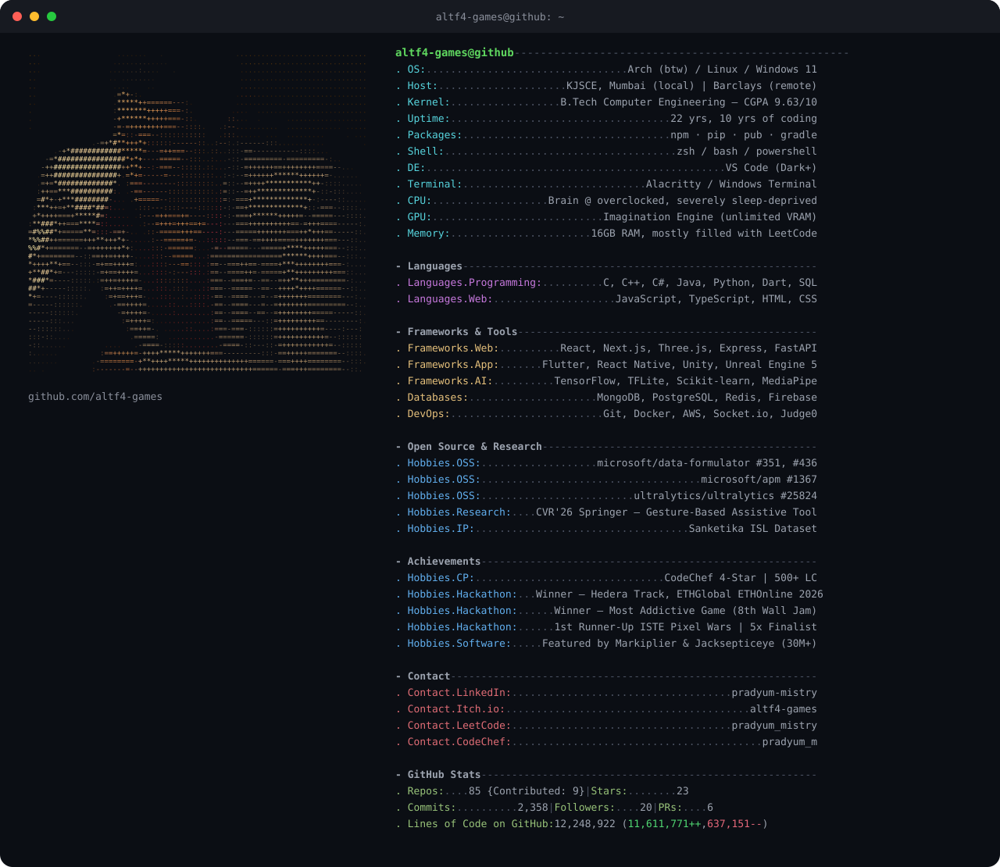

  <picture>
    <source media="(prefers-color-scheme: dark)" srcset="./assets/dark_mode.svg">
    <source media="(prefers-color-scheme: light)" srcset="./assets/light_mode.svg">
    
  </picture>

    

  
   
  

    

  

### 🔧 Recent open-source PRs

<!-- PRS:START -->
| Repo | PR | Merged |
|---|---|---|
| [**volcano-sh/agentcube**](https://github.com/volcano-sh/agentcube) ⭐ 176 | [#484](https://github.com/volcano-sh/agentcube/pull/484) router: stop duplicating X-Forwarded-For | Oct 2026 |
| [**microsoft/data-formulator**](https://github.com/microsoft/data-formulator) ⭐ 17.6k | [#436](https://github.com/microsoft/data-formulator/pull/436) Add Hindi (hi) locale for frontend i18n | Aug 2026 |
| [**ultralytics/ultralytics**](https://github.com/ultralytics/ultralytics) ⭐ 62.8k | [#25824](https://github.com/ultralytics/ultralytics/pull/25824) Fix #25764: Don't send local project paths as Platform slugs | Aug 2026 |
| [**microsoft/apm**](https://github.com/microsoft/apm) ⭐ 4.1k | [#1367](https://github.com/microsoft/apm/pull/1367) refactor(cli): clean up compilation config and registry c... | May 2026 |
| [**microsoft/data-formulator**](https://github.com/microsoft/data-formulator) ⭐ 17.6k | [#351](https://github.com/microsoft/data-formulator/pull/351) fix: 2 agent bugs and improve test coverage | May 2026 |
<!-- PRS:END -->

### 🏆 Achievements

<!-- ACHIEVEMENTS:START -->
- 🏆 Winner — Hedera Track, ETHGlobal ETHOnline 2026
- 🏆 Winner — Most Addictive Game (8th Wall Jam)
- 🏆 1st Runner-Up ISTE Pixel Wars | 5x Finalist
- 🏆 Featured by Markiplier & Jacksepticeye (30M+)
- 🏆 CodeChef 4-Star | 500+ LeetCode
- 🏆 CVR'26 Springer — Gesture-Based Assistive Tool
- 🏆 Sanketika ISL Dataset (IP)
<!-- ACHIEVEMENTS:END -->

  <picture>
    <source media="(prefers-color-scheme: dark)" srcset="https://raw.githubusercontent.com/altf4-games/altf4-games/output/github-contribution-grid-snake-dark.svg">
    <source media="(prefers-color-scheme: light)" srcset="https://raw.githubusercontent.com/altf4-games/altf4-games/output/github-contribution-grid-snake.svg">
    
  </picture>

    

  
  
  
  

