<!-- Edit profile.yml, not this file: the cards in assets/ and the marked
     blocks below are rebuilt by .github/workflows/update-readme.yml. -->

<picture><source media="(prefers-color-scheme: dark)" srcset="./assets/dark/s01.svg">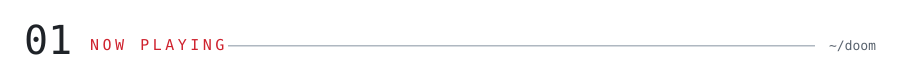</picture>

<picture><source media="(prefers-color-scheme: dark)" srcset="./assets/dark/terminal.svg"></picture>

  

<picture><source media="(prefers-color-scheme: dark)" srcset="https://skillicons.dev/icons?i=cpp%2Ccs%2Cpy%2Cgo%2Cts%2Creact%2Cnextjs%2Cfastapi%2Cflutter%2Cunity%2Cunreal%2Ctensorflow%2Csolidity%2Cpostgres%2Cdocker%2Ckubernetes%2Caws&theme=dark&perline=17"></picture>

<picture><source media="(prefers-color-scheme: dark)" srcset="./assets/dark/s02.svg">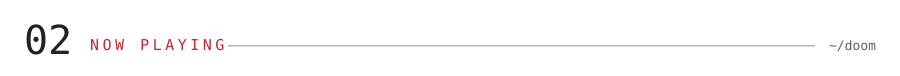</picture>

<picture><source media="(prefers-color-scheme: dark)" srcset="./assets/dark/s03.svg">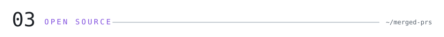</picture>

<picture><source media="(prefers-color-scheme: dark)" srcset="./assets/dark/experience.svg">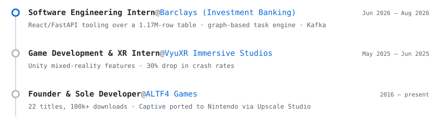</picture>

<picture><source media="(prefers-color-scheme: dark)" srcset="./assets/dark/s04.svg">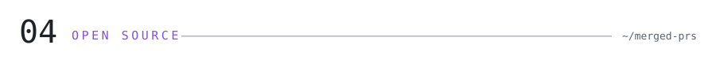</picture>

<!-- PRS:START -->
<a href="https://github.com/volcano-sh/agentcube/pull/484"><picture><source media="(prefers-color-scheme: dark)" srcset="./assets/dark/pr-1.svg">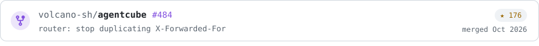</picture></a>
<a href="https://github.com/microsoft/data-formulator/pull/436"><picture><source media="(prefers-color-scheme: dark)" srcset="./assets/dark/pr-2.svg"></picture></a>
<a href="https://github.com/ultralytics/ultralytics/pull/25824"><picture><source media="(prefers-color-scheme: dark)" srcset="./assets/dark/pr-3.svg">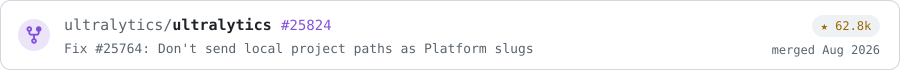</picture></a>
<a href="https://github.com/microsoft/apm/pull/1367"><picture><source media="(prefers-color-scheme: dark)" srcset="./assets/dark/pr-4.svg">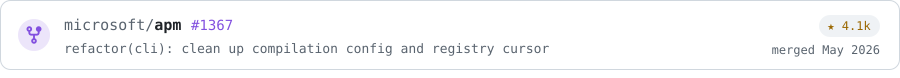</picture></a>
<a href="https://github.com/microsoft/data-formulator/pull/351"><picture><source media="(prefers-color-scheme: dark)" srcset="./assets/dark/pr-5.svg">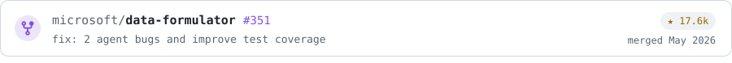</picture></a>
<!-- PRS:END -->

<picture><source media="(prefers-color-scheme: dark)" srcset="./assets/dark/s05.svg"></picture>

<!-- RESEARCH:START -->
<a href="https://doi.org/10.1007/978-3-032-39794-2_32"><picture><source media="(prefers-color-scheme: dark)" srcset="./assets/dark/research-1.svg">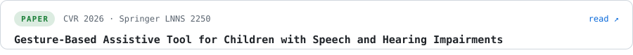</picture></a>
<picture><source media="(prefers-color-scheme: dark)" srcset="./assets/dark/research-2.svg">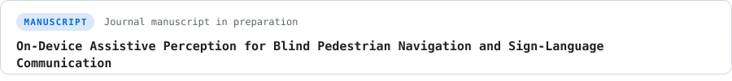</picture>
<picture><source media="(prefers-color-scheme: dark)" srcset="./assets/dark/research-3.svg">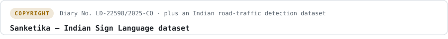</picture>
<!-- RESEARCH:END -->

<picture><source media="(prefers-color-scheme: dark)" srcset="./assets/dark/s06.svg">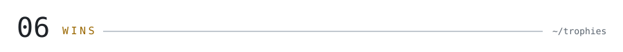</picture>

<picture><source media="(prefers-color-scheme: dark)" srcset="./assets/dark/wins.svg">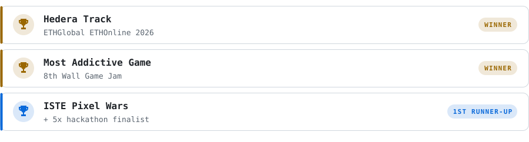</picture>

<a href="https://pradyum.vercel.app"><picture><source media="(prefers-color-scheme: dark)" srcset="https://img.shields.io/badge/PORTFOLIO-0d1117?style=flat-square&logo=googlechrome&logoColor=ffffff"></picture></a>
<a href="https://linkedin.com/in/pradyum-mistry"><picture><source media="(prefers-color-scheme: dark)" srcset="https://img.shields.io/badge/LINKEDIN-0d1117?style=flat-square&logo=linkedin&logoColor=ffffff"></picture></a>
<a href="https://altf4-games.itch.io"><picture><source media="(prefers-color-scheme: dark)" srcset="https://img.shields.io/badge/ITCH.IO-0d1117?style=flat-square&logo=itchdotio&logoColor=ffffff"></picture></a>
<a href="https://leetcode.com/u/pradyum_mistry"><picture><source media="(prefers-color-scheme: dark)" srcset="https://img.shields.io/badge/LEETCODE-0d1117?style=flat-square&logo=leetcode&logoColor=ffffff"></picture></a>
<a href="https://www.codechef.com/users/pradyum_m"><picture><source media="(prefers-color-scheme: dark)" srcset="https://img.shields.io/badge/CODECHEF-0d1117?style=flat-square&logo=data%3Aimage%2Fsvg%2Bxml%3Bbase64%2CPHN2ZyB4bWxucz0iaHR0cDovL3d3dy53My5vcmcvMjAwMC9zdmciIHZpZXdCb3g9IjAgMCAyNCAyNCI%2BPHBhdGggZmlsbD0iI2ZmZmZmZiIgZD0iTTEyIDNhNC41IDQuNSAwIDAgMSA0LjIgMi45QTQgNCAwIDAgMSAxOCAxMy43VjE3SDZ2LTMuM0E0IDQgMCAwIDEgNy44IDUuOSA0LjUgNC41IDAgMCAxIDEyIDN6TTYgMTguNWgxMlYyMUg2eiIvPjwvc3ZnPg%3D%3D"></picture></a>

<picture><source media="(prefers-color-scheme: dark)" srcset="./assets/dark/footer.svg"></picture>
